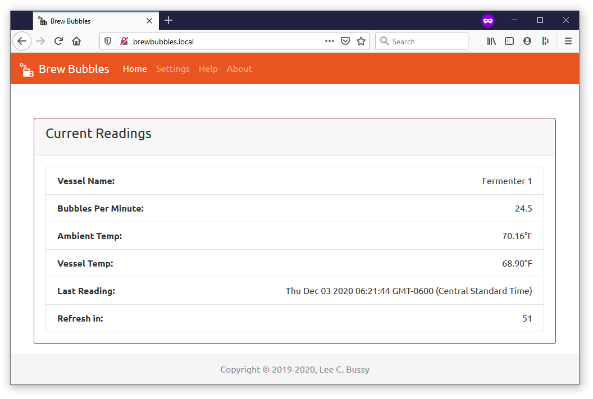

Brew Bubbles Documentation
==========================

Brew Bubbles is a mature, stable product with no intended roadmap changes. It is maintained for historical reference only. No new releases, upgrades, or individual support are promised. Firmware 2.2.3 is the final supported version.

One of the very first things a homebrewer does in the morning after a brew day is rush to the fermenter and look to see if the airlock is bubbling. Just in case you are not quite at the point you take a day off afterward, or even remember to brew on Saturday, this project is for you.

Brew Bubbles is a combination hardware/software solution for homebrewers. Brew Bubbles intends to monitor the fermentation process by counting and reporting bubbles in an S-type airlock as “Bubbles per Minute” (BPM.) Also, since not everyone has a fancy fermentation chamber and temperature control, Brew Bubbles optionally reports your fermenter’s temperature as well as that of which the room in which the fermenter rests. All of these reports in a compact mobile-responsive web page served by Brew Bubbles.

If you use temperature control already, such as BrewPi Remix or Fermentrack, Brew Bubbles reports that data to display in that solution. If you use a cloud dashboard for your brews, such as Brewer’s Friend, you can display the data there as well.

Community Channels
------------------

Use `GitHub Discussions`_ for questions and community help. Report reproducible defects through `GitHub Issues`_. These channels remain active, but individual support and response times are not promised.

Table of Contents
-----------------

.. toctree::
    :maxdepth: 2

    prerequisites/index.rst
    assembly/index.rst
    installation/index.rst
    setup/index.rst
    configuration/index.rst
    firmwareupdate/index.rst
    wifireset/index.rst
    api/index.rst
    troubleshooting/index.rst

.. _GitHub Discussions: https://github.com/lbussy/brew-bubbles/discussions
.. _GitHub Issues: https://github.com/lbussy/brew-bubbles/issues
.. _BrewPi Remix: https://www.brewpiremix.com
.. _Fermentrack: https://www.fermentrack.com
